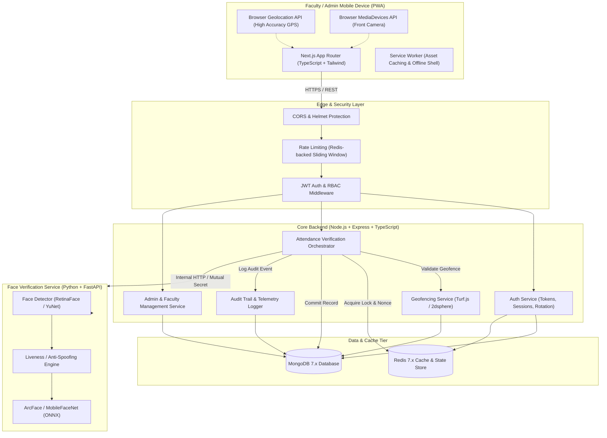
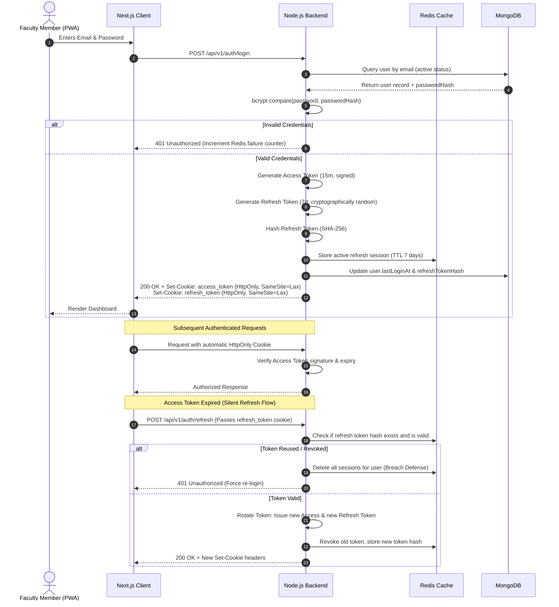
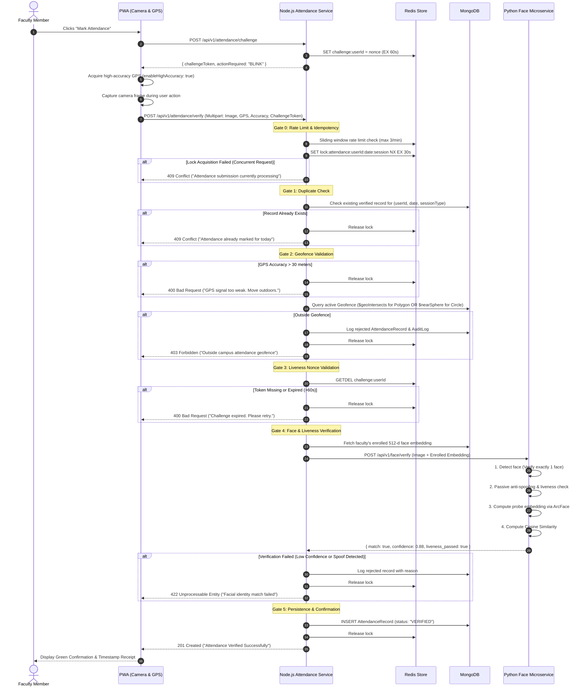

# Geo-Verified Faculty Attendance System
## Production-Grade System Architecture & Technical Specification

---

## 1. System Architecture

### 1.1 Overview & System Boundaries
The **Geo-Verified Faculty Attendance System** is an enterprise-ready, mobile-first Progressive Web Application (PWA) designed to eliminate biometric queue bottlenecks for college faculty. The platform enforces high-assurance attendance marking through a multi-gate verification pipeline:

1. **Identity Authentication** (Role-Based JWT via HTTP-only Cookies).
2. **Server-Side Geofence Validation** (GeoJSON 2dsphere polygon/radial spatial queries).
3. **Camera & Liveness Challenge** (Active challenge token with single-use nonce).
4. **Facial Verification Engine** (Isolated Python FastAPI microservice using deep embeddings).
5. **Idempotency & Duplicate Prevention** (Redis distributed locking + MongoDB compound unique indexes).
6. **Immutable Audit Logging** (Full telemetry captured for every verification attempt).



### 1.2 Technology Decisions & Justifications

| Component | Selected Technology | Technical Justification |
| :--- | :--- | :--- |
| **Frontend Framework** | Next.js (App Router), React, TypeScript | Server Components for fast initial loads, client components for sensor access, native PWA manifest support, strict typing. |
| **Styling** | Tailwind CSS | Utility-first, mobile-first responsive layout, zero runtime CSS overhead, accessible color contrast. |
| **Backend Framework** | Node.js, Express, TypeScript | Highly scalable asynchronous I/O, rich ecosystem for middleware (Helmet, Cookie-Parser), first-class MongoDB driver support. |
| **Database** | MongoDB 7.x + Mongoose | Native GeoJSON `2dsphere` spatial indexing for geofences, polymorphic audit documents, flexible employee schemas. |
| **In-Memory Store** | Redis 7.x (`ioredis`) | Microsecond-latency rate limiting, atomic distributed locks (`SET NX PX`) for idempotency, short-lived (60s) liveness challenges. |
| **Face Verification** | Python 3.11 + FastAPI + ONNX Runtime | Python is the industry standard for computer vision; FastAPI yields high throughput with native async support; ONNX Runtime provides optimized CPU/GPU inference for ArcFace without heavy PyTorch runtime overhead. |
| **Containerization** | Docker & Docker Compose | Uniform local development and reproducible production builds with private container networking. |

---

## 2. Directory Structure

```
geo-faculty-attendance/
├── frontend/                               # Next.js Mobile-First PWA
│   ├── public/
│   │   ├── icons/                          # PWA splash and app icons
│   │   ├── manifest.json                   # Web app manifest
│   │   └── sw.js                           # Custom Service Worker
│   ├── src/
│   │   ├── app/
│   │   │   ├── (auth)/
│   │   │   │   └── login/page.tsx          # Faculty & Admin Login
│   │   │   ├── (faculty)/
│   │   │   │   ├── layout.tsx              # Faculty navigation shell
│   │   │   │   ├── dashboard/page.tsx      # Today's status, quick check-in
│   │   │   │   ├── attendance/page.tsx     # Live verification camera + GPS
│   │   │   │   └── history/page.tsx        # Personal attendance log
│   │   │   ├── (admin)/
│   │   │   │   ├── layout.tsx              # Admin dashboard layout
│   │   │   │   ├── dashboard/page.tsx      # College-wide analytics
│   │   │   │   ├── faculty/page.tsx        # Faculty roster & onboarding
│   │   │   │   ├── geofence/page.tsx       # Campus polygon/circle editor
│   │   │   │   └── reports/page.tsx        # Attendance export & audit logs
│   │   │   ├── layout.tsx                  # Root layout
│   │   │   └── page.tsx                    # Landing / Smart redirect
│   │   ├── components/
│   │   ├── hooks/
│   │   │   ├── useCamera.ts                # Camera stream & frame grabber
│   │   │   ├── useGeolocation.ts           # High-accuracy watchPosition/getCurrentPosition
│   │   │   └── useAuth.ts                  # User context & session hooks
│   │   ├── lib/
│   │   │   ├── api-client.ts               # Axios/Fetch wrapper with interceptors
│   │   │   └── utils.ts                    # Formatters and coordinate helpers
│   │   └── types/                          # Shared frontend contracts
│   ├── next.config.mjs
│   ├── tailwind.config.ts
│   ├── tsconfig.json
│   └── package.json
│
├── backend/                                # Node.js Express TypeScript API
│   ├── src/
│   │   ├── config/
│   │   │   ├── db.ts                       # Mongoose connection with pool sizing
│   │   │   ├── env.ts                      # Strict Zod environment schema
│   │   │   └── redis.ts                    # ioredis client singleton
│   │   ├── constants/
│   │   │   ├── roles.ts                    # Role enum ('FACULTY', 'ADMIN')
│   │   │   └── errors.ts                   # Standardized error codes
│   │   ├── controllers/
│   │   ├── middleware/
│   │   ├── models/
│   │   │   ├── user.model.ts               # Faculty & Admin schema
│   │   │   ├── geofence.model.ts           # 2dsphere GeoJSON schema
│   │   │   ├── attendance.model.ts         # Attendance record & verification audit
│   │   │   └── auditLog.model.ts           # Administrative audit trails
│   │   ├── routes/
│   │   ├── services/
│   │   ├── utils/
│   │   ├── types/
│   │   ├── validations/
│   │   ├── app.ts
│   │   └── server.ts
│   ├── tests/
│   ├── Dockerfile
│   ├── tsconfig.json
│   └── package.json
│
├── face-service/                           # Python FastAPI Computer Vision Service
│   ├── app/
│   │   ├── api/v1/
│   │   ├── core/
│   │   ├── services/
│   │   │   ├── face_engine.py              # ArcFace ONNX embedding inference
│   │   │   ├── detector.py                 # YuNet / RetinaFace detector & alignment
│   │   │   └── liveness_engine.py          # Blink / passive texture anti-spoofing
│   │   ├── schemas/
│   │   └── main.py
│   ├── weights/
│   ├── tests/
│   ├── Dockerfile
│   └── requirements.txt
│
├── docs/                                   # Architectural diagrams and runbooks
├── docker-compose.yml                      # Full-stack orchestrator
├── .env.example
├── .gitignore
└── README.md
```

---

## 3. Database Entities & Schemas (MongoDB / Mongoose)

### 3.1 User Entity (`users` collection)
Stores faculty members and administrators. Facial biometric vectors are stored as float vectors.

```typescript
export type UserRole = 'FACULTY' | 'ADMIN';
export type UserStatus = 'ACTIVE' | 'INACTIVE' | 'SUSPENDED';

export interface IUser {
  _id: mongoose.Types.ObjectId;
  employeeId: string;              // Unique e.g. "FAC-2024-001"
  email: string;                   // Normalized lowercase
  passwordHash: string;            // bcrypt (12 rounds)
  fullName: string;
  department: string;              // e.g. "Computer Science & Engineering"
  designation: string;             // e.g. "Associate Professor"
  phone?: string;
  role: UserRole;
  status: UserStatus;
  faceEnrolled: boolean;
  faceEmbedding?: number[];        // 512-dimensional float vector (ArcFace)
  faceEnrolledAt?: Date;
  refreshTokenHash?: string;       // SHA-256 hash of active refresh token
  lastLoginAt?: Date;
  createdAt: Date;
  updatedAt: Date;
}
```

**Indexes:**
- `{ employeeId: 1 }` (Unique)
- `{ email: 1 }` (Unique)
- `{ role: 1, status: 1 }`

---

### 3.2 Geofence Entity (`geofences` collection)
Defines authorized physical attendance boundaries using standard GeoJSON geometry with 2dsphere indexing.

```typescript
export type GeofenceType = 'POLYGON' | 'CIRCLE';

export interface IGeofence {
  _id: mongoose.Types.ObjectId;
  name: string;                    // e.g. "Main Engineering Campus"
  code: string;                    // Unique identifier e.g. "CAMPUS-MAIN-01"
  description?: string;
  type: GeofenceType;
  
  // For CIRCLE mode
  center?: {
    type: 'Point';
    coordinates: [number, number]; // [longitude, latitude]
  };
  radiusMeters?: number;           // Allowed radius from center

  // For POLYGON mode (Arbitrary campus boundary)
  polygon?: {
    type: 'Polygon';
    coordinates: [number, number][][]; // GeoJSON linear ring: [[lng, lat], ...]
  };

  maxAllowedAccuracyMeters: number;// Default 30 meters
  isActive: boolean;
  allowedDepartments?: string[];   // Empty array means all departments allowed
  createdBy: mongoose.Types.ObjectId; // User (ADMIN) ref
  createdAt: Date;
  updatedAt: Date;
}
```

**Indexes:**
- `{ polygon: '2dsphere' }`
- `{ center: '2dsphere' }`
- `{ code: 1 }` (Unique)
- `{ isActive: 1 }`

---

### 3.3 Attendance Record Entity (`attendancerecords` collection)
Immutable record of verification attempts, capturing full spatial, visual, and device telemetry.

```typescript
export type AttendanceSession = 'CHECK_IN' | 'CHECK_OUT';
export type AttendanceStatus = 'VERIFIED' | 'REJECTED' | 'FLAGGED';

export interface IAttendanceRecord {
  _id: mongoose.Types.ObjectId;
  facultyId: mongoose.Types.ObjectId; // User ref
  date: string;                       // "YYYY-MM-DD" in local college timezone
  sessionType: AttendanceSession;
  status: AttendanceStatus;
  timestamp: Date;                    // Exact server timestamp
  
  // Geofence verification details
  locationVerification: {
    verified: boolean;
    geofenceId?: mongoose.Types.ObjectId;
    geofenceName?: string;
    latitude: number;
    longitude: number;
    accuracyMeters: number;
    calculatedDistanceMeters: number; // Distance from center or polygon edge
    isMockedSuspicion: boolean;
  };

  // Facial verification details
  faceVerification: {
    verified: boolean;
    confidenceScore: number;          // Cosine similarity (0.0 to 1.0)
    matchThreshold: number;           // e.g. 0.70
    livenessPassed: boolean;
    livenessScore: number;            // Confidence of genuine human presence
  };

  // Telemetry & Audit
  deviceAudit: {
    ipAddress: string;
    userAgent: string;
    clientTimestamp: Date;
  };

  rejectionReason?: string;           // e.g. "OUTSIDE_GEOFENCE", "FACE_MISMATCH"
  manualOverride?: {
    overriddenBy: mongoose.Types.ObjectId; // Admin ref
    reason: string;
    overriddenAt: Date;
  };

  createdAt: Date;
}
```

**Compound Unique Index (Duplicate Prevention):**
- `{ facultyId: 1, date: 1, sessionType: 1 }` (Unique) — Guarantees database-level enforcement against duplicate check-ins for the same day.
- `{ date: 1, status: 1 }` (For fast administrative dashboard queries).
- `{ facultyId: 1, timestamp: -1 }` (For personal attendance history).

---

### 3.4 Audit Log Entity (`auditlogs` collection)
Captures all critical administrative actions and suspicious verification failures.

```typescript
export interface IAuditLog {
  _id: mongoose.Types.ObjectId;
  action: 'GEOFENCE_CREATED' | 'GEOFENCE_MODIFIED' | 'FACULTY_ENROLLED' | 
          'ATTENDANCE_OVERRIDE' | 'SUSPICIOUS_ATTENDANCE_ATTEMPT';
  actorId: mongoose.Types.ObjectId;
  actorRole: UserRole;
  targetEntity: 'User' | 'Geofence' | 'AttendanceRecord';
  targetId: mongoose.Types.ObjectId;
  details: Record<string, unknown>;   // Diffs, coordinates, or rejection metadata
  ipAddress: string;
  userAgent: string;
  timestamp: Date;
}
```

---

## 4. REST API Contracts

All endpoints are prefixed with `/api/v1`. Errors follow RFC 7807 problem details specification.

### 4.1 Authentication Endpoints
- `POST /api/v1/auth/login`: Email/password authentication, sets HTTP-only cookies (`access_token`, `refresh_token`).
- `POST /api/v1/auth/refresh`: Silently rotates refresh tokens and issues fresh access tokens.
- `POST /api/v1/auth/logout`: Clears auth cookies and invalidates Redis refresh session.
- `GET /api/v1/auth/me`: Returns profile of the authenticated user.

### 4.2 Attendance Verification Endpoints
- `POST /api/v1/attendance/challenge`: Issues single-use 60s liveness challenge token in Redis.
- `POST /api/v1/attendance/verify`: Multi-gate atomic verification endpoint (accepts multipart payload with selfie image, GPS coordinates, accuracy, and challenge token).
- `GET /api/v1/attendance/today`: Fetches faculty check-in/check-out status for the current day.
- `GET /api/v1/attendance/history`: Paginated personal attendance log with date-range filters.

### 4.3 Faculty & Face Enrollment Endpoints
- `POST /api/v1/faculty/enroll-face`: Generates and persists the 512-d biometric face embedding from an enrollment photo.
- `GET /api/v1/faculty/status`: Checks facial enrollment status and assigned attendance zones.

### 4.4 Admin Management Endpoints
- `GET /api/v1/admin/geofences`: List all configured college geofences.
- `POST /api/v1/admin/geofences`: Create new polygon or circular geofence.
- `PUT /api/v1/admin/geofences/:id`: Update boundary, radius, or active state.
- `GET /api/v1/admin/attendance-records`: Paginated, filterable college-wide attendance grid.
- `POST /api/v1/admin/attendance-records/:id/override`: Admin override for disputed records with mandatory `reason`.
- `GET /api/v1/admin/faculty`: Faculty roster management.

### 4.5 Internal Face Verification Microservice Endpoints
- `POST /api/v1/face/extract`: Computes 512-d normalized float vector from image.
- `POST /api/v1/face/verify`: Computes probe embedding, validates liveness, and measures cosine similarity against enrolled vector.

---

## 5. Authentication Flow



---

## 6. Attendance Verification Pipeline



---

## 7. Security Considerations & Threat Model

| Threat / Attack Vector | Real-World Vulnerability | Technical Mitigation in this System |
| :--- | :--- | :--- |
| **GPS Spoofing / Mock Locations** | Android "Allow mock locations" or browser DevTools overrides can supply arbitrary coordinates. | **1.** Enforce `accuracy <= 30m` (mock locations often report 0 or anomalous values).<br/>**2.** Anomaly detection: flag impossible velocity jumps between login IP geolocation and GPS coordinate.<br/>**3.** Server logs raw telemetry for audit disputes.<br/>*Honest Limitation:* Pure web browsers cannot access kernel-level hardware root-of-trust; critical enterprise deployments require mobile device management (MDM) or native wrappers (Capacitor/Play Integrity) if 100% hardware attestation is mandatory. |
| **Presentation Attacks (Photo / Screen Replay)** | Holding up a printed photo or an iPad displaying the faculty member's photo to the camera. | **1.** Dynamic challenge-response (nonce valid for only 60 seconds).<br/>**2.** Microservice anti-spoofing engine (frequency domain Fourier texture analysis to detect screen moiré patterns and paper reflection).<br/>**3.** Single-frame face detection rejects zero faces or multiple faces in view. |
| **Replay & Relay Attacks** | Intercepting a valid attendance HTTP payload and re-sending it. | **1.** `challengeToken` consumed atomically via Redis `GETDEL` (one-time use).<br/>**2.** Client timestamp checked against server NTP clock ($\Delta t \le 60\text{s}$).<br/>**3.** HTTPS TLS encryption for all transport data. |
| **Race Conditions / Double Clicks** | Submitting multiple simultaneous attendance requests within milliseconds to bypass checks. | **1.** Redis distributed mutex: `SET lock:attendance:{id}:{date}:{session} NX EX 30`.<br/>**2.** MongoDB compound unique index `{ facultyId: 1, date: 1, sessionType: 1 }` prevents concurrent writes at storage level. |
| **Credential Theft & Session Hijacking** | XSS stealing session tokens from `localStorage`. | **1.** Strict prohibition of `localStorage` for JWTs.<br/>**2.** Tokens stored exclusively in `HttpOnly`, `Secure`, `SameSite=Lax` cookies.<br/>**3.** Token rotation: compromised refresh tokens are automatically invalidated upon first reuse detection. |
| **Biometric Privacy Violation** | Storing raw facial photographs can violate privacy laws (GDPR / Indian DPDP Act). | **1.** Raw selfie images are **never** stored permanently in the database.<br/>**2.** Only the non-reversible 512-dimension mathematical vector is retained.<br/>**3.** Vectors are mathematically impossible to reconstruct into the original face photo. |

---

## 8. Development Phases & Implementation Roadmap

1. **Phase 1: Foundation & Infrastructure**: Monorepo orchestration (`frontend`, `backend`, `face-service`), `docker-compose.yml` (MongoDB 7, Redis 7), TypeScript configs, centralized error handling.
2. **Phase 2: Authentication & RBAC Engine**: Mongoose `User` schema, JWT access/refresh token rotation with HTTP-only cookies, Redis token revocation, RBAC middleware.
3. **Phase 3: Geofence Engine & 2dsphere Math**: Mongoose `Geofence` schema with GeoJSON `2dsphere` spatial indexing, `$geoIntersects` and `$nearSphere` queries, GPS accuracy filtering.
4. **Phase 4: Python Face Verification Microservice**: FastAPI service with YuNet face detector, ArcFace ONNX embedding extraction, cosine similarity matching, and liveness anti-spoofing checks.
5. **Phase 5: Multi-Gate Attendance Verification Pipeline**: Node.js orchestrator combining Redis idempotency locks, duplicate checks, geofence checks, challenge token consumption, and face microservice verification.
6. **Phase 6: Mobile-First Next.js PWA**: Responsive UI with Tailwind CSS, `useCamera` WebRTC stream handler, `useGeolocation` high-accuracy hook, verification camera viewfinder, and PWA service worker.
7. **Phase 7: Admin Portal & Audit Reporting**: Faculty roster, interactive geofence map management, filterable attendance tables, CSV export, and manual override audit logging.
8. **Phase 8: Security Hardening, Testing & Documentation**: Jest/Supertest backend tests, pytest microservice tests, rate-limiting stress testing, and production documentation.
